# Lab 14 — Observability: incidents, alerts, SLOs and logs

Ruslanbek Tolametov


**Variant:** A (Tasks 1–5) + Final Challenge. Repository: <https://github.com/Ruslanbek970/lab14-incidents>

## Setup

The ShopLab stack from the handout (`app/`, `compose.yaml`, `monitoring/`), Docker Compose, all images at the versions in the handout.

```bash
mkdir -p dashboards runbooks
docker compose up -d --build
docker compose ps
docker compose logs -f webhook
```

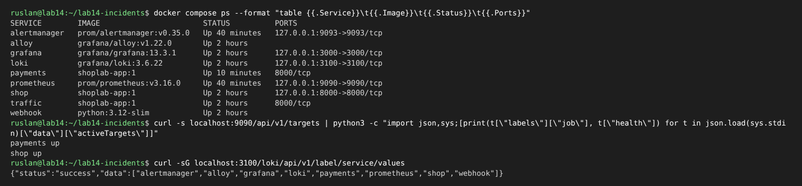

Every deploy and rollback was written down with `date -u`:

| UTC | Action | Used for |
|---|---|---|
| 18:08:48 | `docker compose up -d`, payments 1.0.0, starter rules | Task 1, Task 3 "before" |
| 18:24:04 | `PAYMENTS_VERSION=1.1.0 docker compose up -d payments` | Task 3 "before", Task 4 |
| 18:40:01 | `docker compose up -d payments` (rollback), final rules and routing | Task 3 "after" |
| 19:00:01 | deploy payments 1.1.0 | Task 2, Task 3 "after" |
| 19:40:00 | rollback to 1.0.0 | Task 2 |
| 19:55:00 | deploy 1.1.0 | Final Challenge |
| 20:10:00 / 20:12:00 | `docker compose stop payments` / `start payments` | Final Challenge |
| 20:17:00 | rollback to 1.0.0 | Final Challenge |


## Task 1 — "Search is slow"

PromQL, `job="shop"`, 5-minute windows. Values at 18:20 UTC (payments 1.0.0, after 11 minutes of traffic; the screenshots were taken a few seconds later, so the last digits differ):

```promql
# p50 per route
histogram_quantile(0.50, sum by (route, le) (rate(http_request_duration_seconds_bucket{job="shop"}[5m])))
# p95 per route
histogram_quantile(0.95, sum by (route, le) (rate(http_request_duration_seconds_bucket{job="shop"}[5m])))
# average per route
sum by (route) (rate(http_request_duration_seconds_sum{job="shop"}[5m]))
  / sum by (route) (rate(http_request_duration_seconds_count{job="shop"}[5m]))
# share of /api/search slower than 0.5 s
1 - sum(rate(http_request_duration_seconds_bucket{job="shop",route="/api/search",le="0.5"}[5m]))
  / sum(rate(http_request_duration_seconds_count{job="shop",route="/api/search"}[5m]))
```

| route | average | p50 | p95 |
|---|---|---|---|
| `/api/search` | 0.138 s | 0.042 s | **1.53 s** |
| `/api/checkout` | 0.057 s | 0.061 s | 0.096 s |

Share of searches slower than 0.5 s: **8.5 %**. The slow route is `/api/search`; about one search in twelve takes more than a second, while the average (138 ms) and the median (42 ms) look healthy. The p95 lands in the 1–2.5 s bucket, so its exact value is interpolated; the logs below show the real durations (about 0.9–1.5 s).

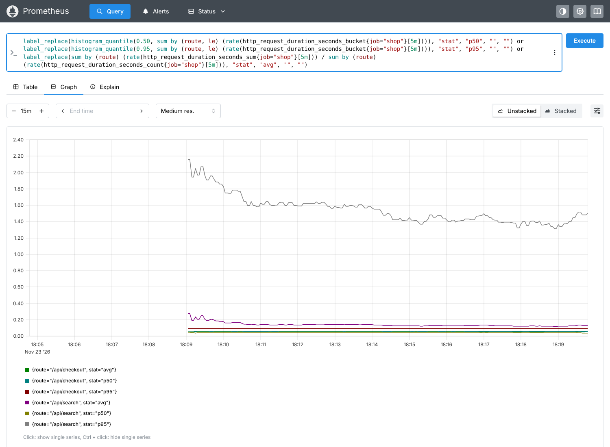

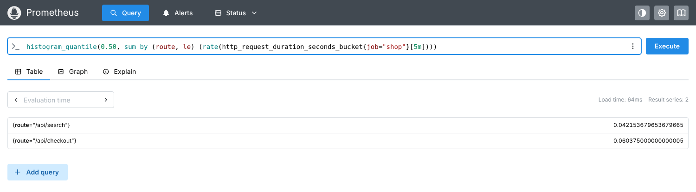


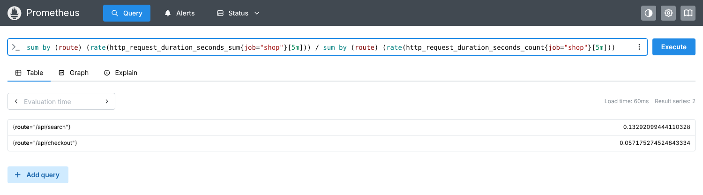

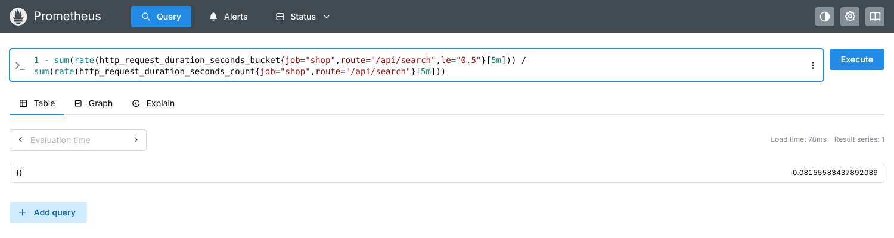

LogQL — the slow searches with their duration and query text:

```logql
{service="shop"} | json | path="/api/search" and duration_ms > 500
  | line_format "{{.duration_ms}}ms  q={{.query}}"
```

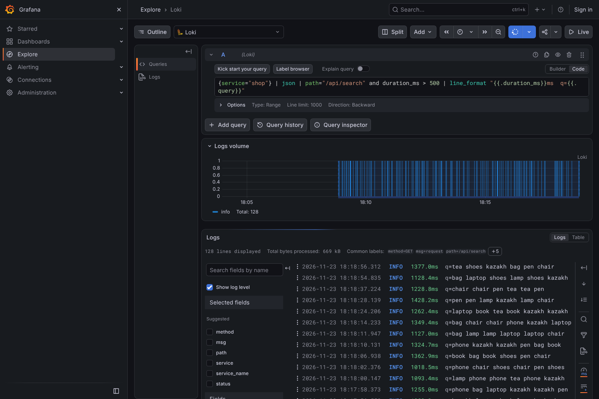

All slow searches are long queries of six words (more than 20 characters, e.g. `q=tea shoes kazakh bag pen chair`); the fast ones have one or two words.

Bonus — the pattern proved with LogQL metric queries over 10 minutes (18:09–18:19):

```logql
sum by (long) (count_over_time({service="shop"} | json | path="/api/search"
  | label_format long=`{{ if gt (len .query) 20 }}yes{{ else }}no{{ end }}`
  | duration_ms > 500 [10m]))

avg by (long) (avg_over_time({service="shop"} | json | path="/api/search"
  | label_format long=`{{ if gt (len .query) 20 }}yes{{ else }}no{{ end }}`
  | unwrap duration_ms [10m]))
```

| long query (> 20 chars) | searches | slower than 500 ms | average duration |
|---|---|---|---|
| no | 1475 | 0 | 41 ms |
| yes | 126 | 126 | 1203 ms |

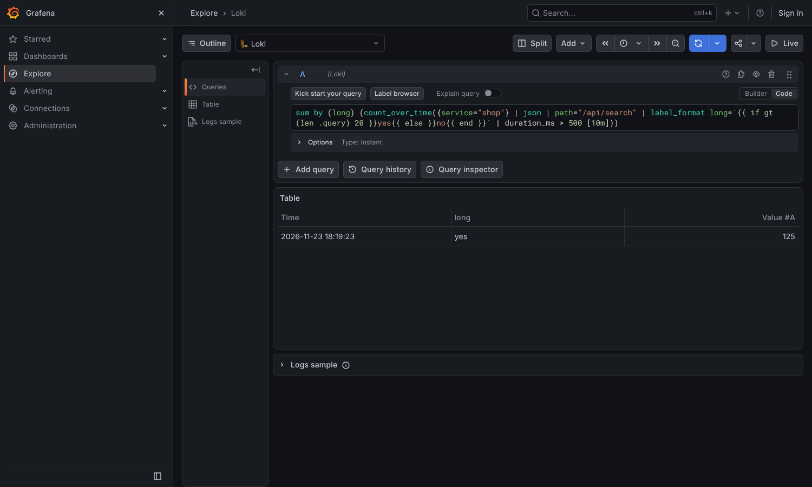

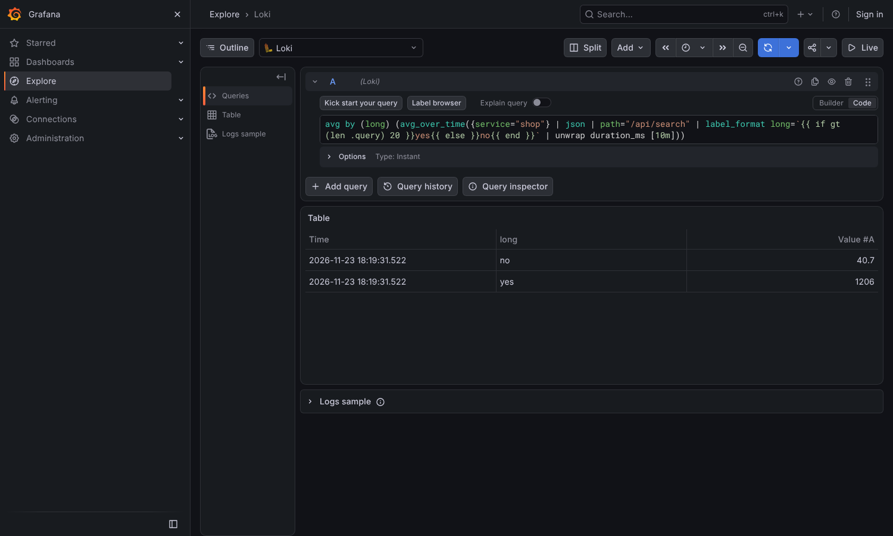

**Why does the average look fine?** Over 90 % of searches take ~40 ms, so they pull the average down to ~140 ms and the median to ~40 ms. The 8 % of long queries that take ~1.2 s are hidden in the mean and are above the median by definition. A percentile in the tail (p95, p99) or the share of requests over a threshold shows them; for the users who typed a long query the shop "hangs" every time.

**Why metrics and logs?** Metrics are cheap and aggregated: they tell *where* (route `/api/search`), *when* and *how many* (8.5 % > 0.5 s), but they have no per-request detail like the query text (it would be a label with unlimited values). Logs keep every request with its fields, so they answer *what* the slow requests have in common (six words, > 20 characters). Metrics find the problem, logs explain it.

## Task 2 — An SLO for checkout, and a burn-rate alert

**SLO:** 99.5 % of checkouts succeed over 30 days.

Error budget = 0.5 % of 30 days = 0.005 × 30 × 24 × 60 = 0.005 × 43 200 min = **216 minutes** of "fully down" per 30 days (3 h 36 min).

burn rate = error ratio / 0.005. A burn rate of 1 uses exactly the whole budget in 30 days; 14.4 uses 2 % of it in one hour (the budget is gone in ~2 days); 6 uses 5 % in six hours (gone in 5 days).

Recording rules (`monitoring/rules.yml`, group `checkout-slo-recording`), one per window — 5m, 30m, 1h, 6h:

```yaml
- record: shop:checkout_error_ratio:rate5m
  expr: |
    (sum(rate(http_requests_total{job="shop",route="/api/checkout",status=~"5.."}[5m])) or vector(0))
    / sum(rate(http_requests_total{job="shop",route="/api/checkout"}[5m]))
# same for [30m] -> :rate30m, [1h] -> :rate1h, [6h] -> :rate6h
```

`or vector(0)` gives 0 instead of "no data" while there are no 5xx at all.

Alerts (group `checkout-slo-alerts`), two windows each:

```yaml
- alert: CheckoutErrorBudgetFastBurn
  expr: |
    shop:checkout_error_ratio:rate1h / 0.005 > 14.4
    and shop:checkout_error_ratio:rate5m / 0.005 > 14.4
  for: 2m
  labels: { severity: page, service: shop, route: /api/checkout }
  annotations:
    summary: "Checkout burns the 30-day error budget {{ $value | printf \"%.1f\" }}x too fast (1h window, page at 14.4x)"
    runbook_url: "https://github.com/Ruslanbek970/lab14-incidents/blob/main/runbooks/checkout-slo.md"
- alert: CheckoutErrorBudgetSlowBurn
  expr: |
    shop:checkout_error_ratio:rate6h / 0.005 > 6
    and shop:checkout_error_ratio:rate30m / 0.005 > 6
  for: 5m
  labels: { severity: ticket, service: shop, route: /api/checkout }
  annotations:
    summary: "Checkout burns the 30-day error budget {{ $value | printf \"%.1f\" }}x too fast (6h window, ticket at 6x)"
    runbook_url: "https://github.com/Ruslanbek970/lab14-incidents/blob/main/runbooks/checkout-slo.md"
```

The runbook is `runbooks/checkout-slo.md` (confirm with PromQL, find the failing card type with LogQL, check for a deploy, roll back).

```bash
docker run --rm -v "$PWD/monitoring:/m" --entrypoint promtool prom/prometheus:v3.16.0 check rules /m/rules.yml
# SUCCESS: 8 rules found
```

### The release

Prometheus was started with an empty TSDB at 18:41:30 UTC (so the windows contain only this experiment). Payments ran 1.0.0 until the deploy:

| UTC | Event |
|---|---|
| 19:00:01 | `PAYMENTS_VERSION=1.1.0 docker compose up -d payments` |
| 19:04–19:06 | 5m burn rate passes 14.4 (error ratio ~10 %: every unionpay checkout fails) |
| 19:09:21 | `HighErrorRatio{job="payments"}` firing (notified 19:09:36, "11.21 % of requests return 5xx") |
| 19:09:51 | `CheckoutErrorBudgetSlowBurn` pending (6h and 30m burn rate > 6) |
| 19:14:53 | `CheckoutErrorBudgetSlowBurn` **firing**, 6h burn rate 7.8 (5m: 17.7, 30m: 8.7) |
| 19:15:16 | webhook: `[FIRING] CheckoutErrorBudgetSlowBurn … 7.8x too fast (6h window, ticket at 6x)` |
| 19:40:00 | rollback `docker compose up -d payments`; 1h burn rate at that moment 12.6, 5m 17.8 |
| 19:45:32 | 5m burn rate back to 0 |
| — | `CheckoutErrorBudgetFastBurn` never fired: the 1h burn rate peaked at **12.6 < 14.4** |

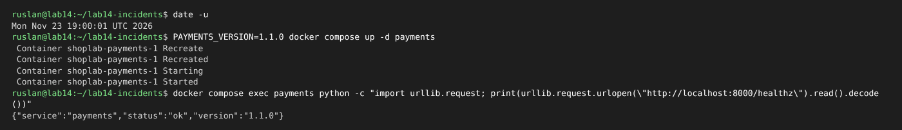

Burn rate samples (`shop:checkout_error_ratio:rate<window> / 0.005`, every 30 s, from `logs/burn-sampler.txt`):

```text
19:09:51 burn5m=22.6 burn30m=6.1  burn1h=6.1  burn6h=6.1  | SlowBurn:pending  HighErrorRatio:firing
19:14:53 burn5m=17.7 burn30m=8.7  burn1h=7.8  burn6h=7.8  | SlowBurn:firing   HighErrorRatio:firing
19:40:00 burn5m=17.8 burn30m=18.7 burn1h=12.6 burn6h=12.6 | SlowBurn:firing   HighErrorRatio:firing
19:45:32 burn5m=0.0  burn30m=15.9 burn1h=12.5 burn6h=11.7 | SlowBurn:firing
```

Queries:

```promql
shop:checkout_error_ratio:rate5m / 0.005        # and :rate30m, :rate1h, :rate6h
sum(rate(http_requests_total{job="shop",route="/api/checkout",status=~"5.."}[1h]))
  / sum(rate(http_requests_total{job="shop",route="/api/checkout"}[1h]))
ALERTS{alertname=~"Checkout.*"}
```

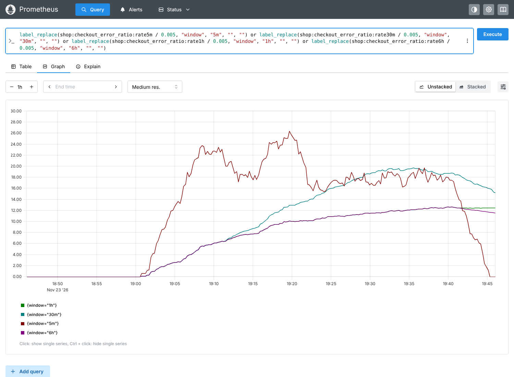

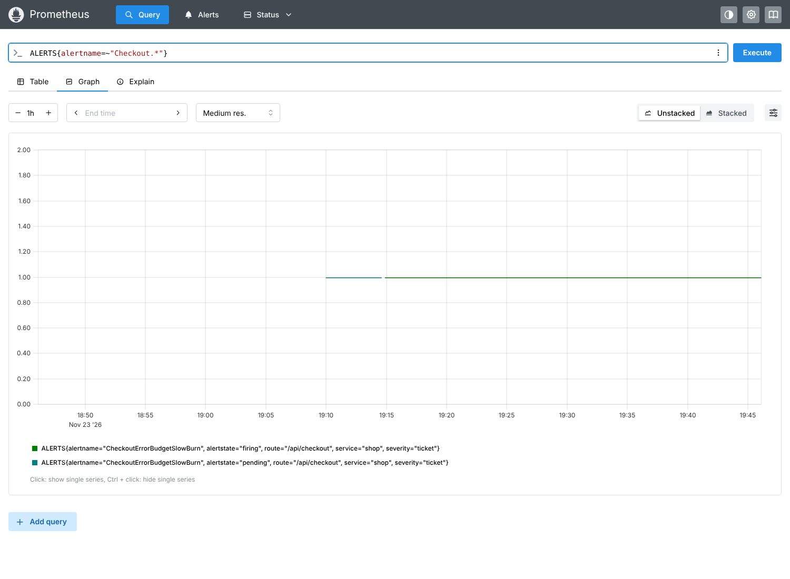

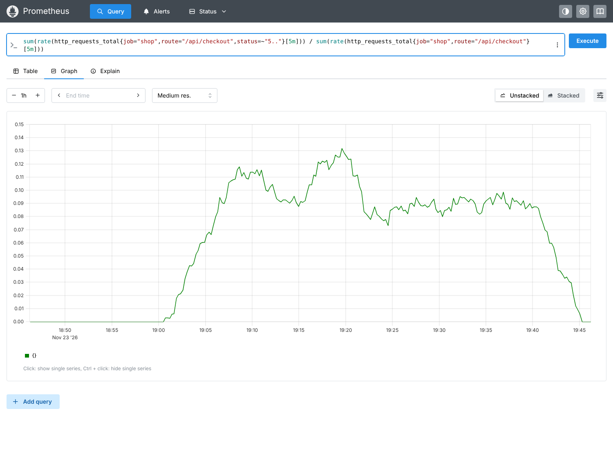

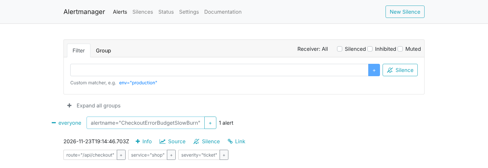

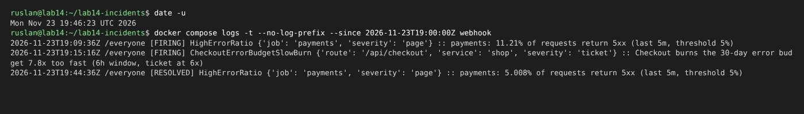

**Why the burn rate instead of "error ratio > 0.5 %"?** A static threshold at the SLO fires on every short blip (a single 500 in a quiet minute is > 0.5 %) and says nothing about urgency. The burn rate measures how fast the monthly budget is spent, so the threshold maps to a business consequence: 14.4× means "2 % of the month's budget per hour, the budget is gone in two days — wake someone", 6× means "fix it this week". Small, short error spikes that the budget can absorb don't page.

**Why two windows?** The long window (1h / 6h) proves the problem is big enough to matter, so a few bad seconds don't page. The short window (5m / 30m) proves it is still happening now: after the rollback the 5m burn rate dropped to 0 within 5 minutes, while the 1h window still showed 12.5. Without the short window an alert would keep firing for up to an hour after the fix; without the long window it would flap on every spike.

**Why didn't the fast-burn alert fire soon after the deploy?** The error ratio jumped at once (5m burn rate 18–26), but the alert also needs the **1h** average above 14.4. Only one card in ten (unionpay) fails, so the real burn rate was ~18–20, just above the threshold, and the 1h window also contained clean minutes from before the deploy. After 40 minutes the 1h burn rate had only climbed to 12.6, so the page never fired; at this speed it would have needed about 65–70 minutes of the bad release. The slow-burn ticket (6×) fired 15 minutes after the deploy. That is the intended behaviour: a total outage (burn rate 200) fills the 1h window in a few minutes and pages fast, a partial failure is reported as a ticket first.

## Task 3 — The noisy alert

### Before: the starter config

Starter `ErrorsDetected` (`rate(http_requests_total{status=~"5.."}[1m]) > 0`, no `for`, `summary: "errors!!!"`) with the starter routing (`group_by: ["..."]`, `group_wait: 0s`, `repeat_interval: 1m`). Payments 1.0.0 from 18:09 to 18:24, 1.1.0 from 18:24:04 to 18:39 UTC.

```bash
docker compose logs --since 2026-11-23T18:09:00Z --until 2026-11-23T18:24:00Z webhook | grep -c FIRING   # 8
docker compose logs --since 2026-11-23T18:24:00Z --until 2026-11-23T18:39:00Z webhook | grep -c FIRING   # 40
docker compose logs --since 2026-11-23T18:09:00Z --until 2026-11-23T18:39:00Z webhook | grep -c RESOLVED # 12
```

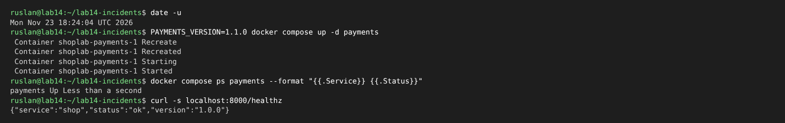

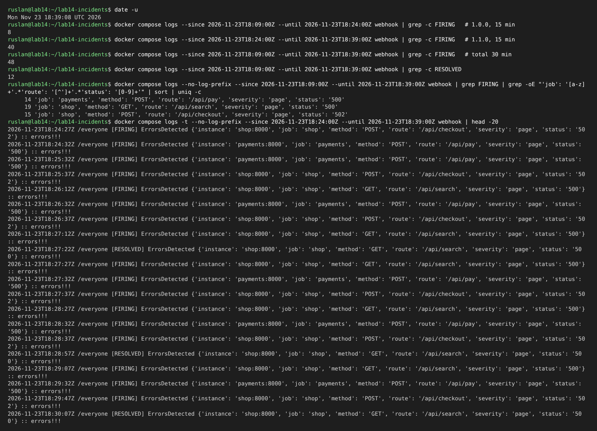

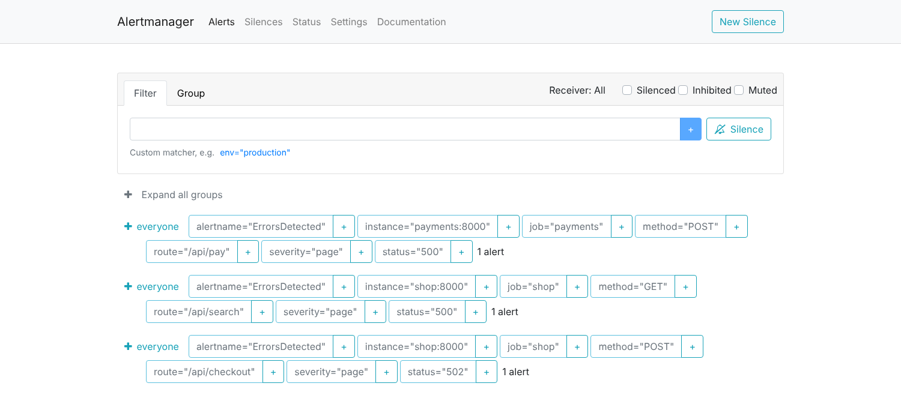

| period (starter config) | FIRING notifications | what they were |
|---|---|---|
| 1.0.0, 15 min | 8 | all `/api/search` 500 — the random 0.5 % "try again" errors |
| 1.1.0, 15 min | 40 | 15 × shop `/api/checkout` 502, 14 × payments `/api/pay` 500, 11 × `/api/search` 500 |
| + RESOLVED | 12 | the search alert flapping firing ↔ resolved |

**Which needed a human?** One. The first checkout/pay notification after the deploy was a real incident (unionpay payments broken). The other 28 checkout/pay notifications were repeats of the same incident every minute, split into two alerts for one cause, and all 19 search notifications (plus the 12 RESOLVED) were noise: a 0.5 % random error rate that the client retries.

### The fix

`ErrorsDetected` was removed and replaced with a ratio alert per service (`monitoring/rules.yml`, group `errors`):

```yaml
- alert: HighErrorRatio
  expr: |
    sum by (job) (rate(http_requests_total{status=~"5.."}[5m]))
      / sum by (job) (rate(http_requests_total[5m])) > 0.05
    and sum by (job) (rate(http_requests_total[5m])) > 0.1
  for: 5m
  labels: { severity: page }
  annotations:
    summary: "{{ $labels.job }}: {{ $value | humanizePercentage }} of requests return 5xx (last 5m, threshold 5%)"
    runbook_url: "https://github.com/Ruslanbek970/lab14-incidents/blob/main/runbooks/high-error-ratio.md"
```

- a **ratio** (5 % of the service's requests), not "any error";
- a **minimum of traffic** (> 0.1 req/s), so one error in an empty minute is not 100 %;
- `for: 5m`, **per service** (`by (job)`), a summary with the number, a runbook.

`monitoring/alertmanager.yml`:

```yaml
route:
  receiver: everyone
  group_by: [alertname, job]   # one notification per alert and service, not per label set
  group_wait: 30s              # wait for related alerts, send them together
  group_interval: 5m           # new alerts in an existing group: at most every 5 min
  repeat_interval: 4h          # remind about a still-firing alert every 4 h, not every minute
receivers:
  - name: everyone
    webhook_configs:
      - url: http://webhook:8080/everyone
        send_resolved: true
```

```bash
docker run --rm -v "$PWD/monitoring:/m" --entrypoint promtool prom/prometheus:v3.16.0 check rules /m/rules.yml
docker run --rm -v "$PWD/monitoring:/m" --entrypoint amtool prom/alertmanager:v0.35.0 check-config /m/alertmanager.yml
docker compose rm -sfv prometheus alertmanager && docker compose up -d prometheus alertmanager
```

Prometheus and Alertmanager were re-created with empty storage (instead of `/-/reload`) so the second window does not inherit the errors and alert state of the first one.

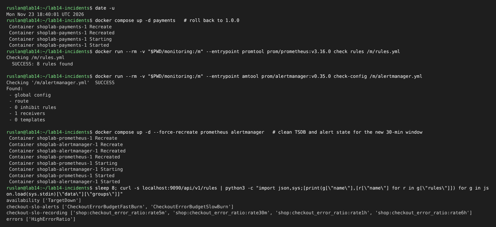

### After: the same 30 minutes

Payments 1.0.0 from 18:45 to 19:00, 1.1.0 from 19:00:01 to 19:15 UTC.

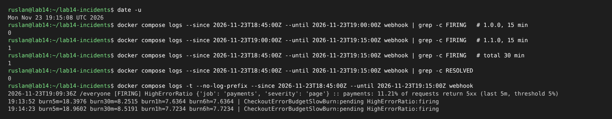

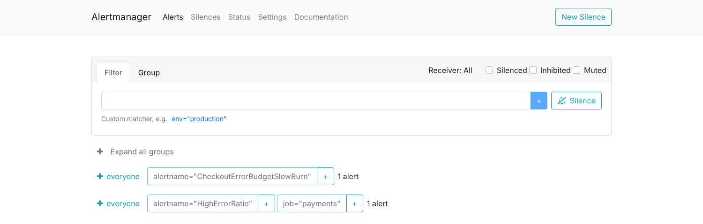

| | starter config | final config |
|---|---|---|
| FIRING, 1.0.0 (15 min) | 8 | **0** |
| FIRING, 1.1.0 (15 min) | 40 | **1** |
| RESOLVED | 12 | 0 |
| **notifications in 30 min** | **60** | **1** |
| needed a human | 1 | 1 |
| time from deploy to first notification | 23 s | 9 min 35 s |

The one notification: `19:09:36 [FIRING] HighErrorRatio {'job': 'payments', 'severity': 'page'} :: payments: 11.21% of requests return 5xx (last 5m, threshold 5%)`. It names the service that causes the errors and the size of the problem. The shop's share of 5xx stayed below 5 % (the checkout SLO alerts cover the customer impact; `CheckoutErrorBudgetSlowBurn` became a ticket at 19:15:16, just after this window).

**What is alert fatigue and why is it dangerous?** When most notifications need no action, people stop reading them: they mute the channel, as the previous team did. Then the one real alert (payments broken) is lost among 60 messages and the incident is found by customers. Noise also costs sleep and trust in monitoring.

**What makes an alert actionable?** It fires only on user-visible impact that needs a human now (or a ticket), it says what is broken and how badly (service, number), it points to a runbook with the first steps, it is not duplicated per label combination and doesn't repeat every minute, and it resolves when the problem is gone.

**Why does a single 500 on /api/search not deserve a page?** It is 0.5 % background noise that the user fixes by retrying; it spends almost none of the error budget and there is nothing for an engineer to do at 3 a.m. Only a sustained ratio over a threshold (or a fast budget burn) means real users are failing.

## Task 4 — Follow one checkout across two services

The customer's screenshot shows `X-Request-ID: 5ed1b80addd84306` (a real failing checkout from 18:24:26 UTC, payments 1.1.0).

Find failing checkouts in the shop's logs:

```logql
{service="shop"} | json | status=502
```

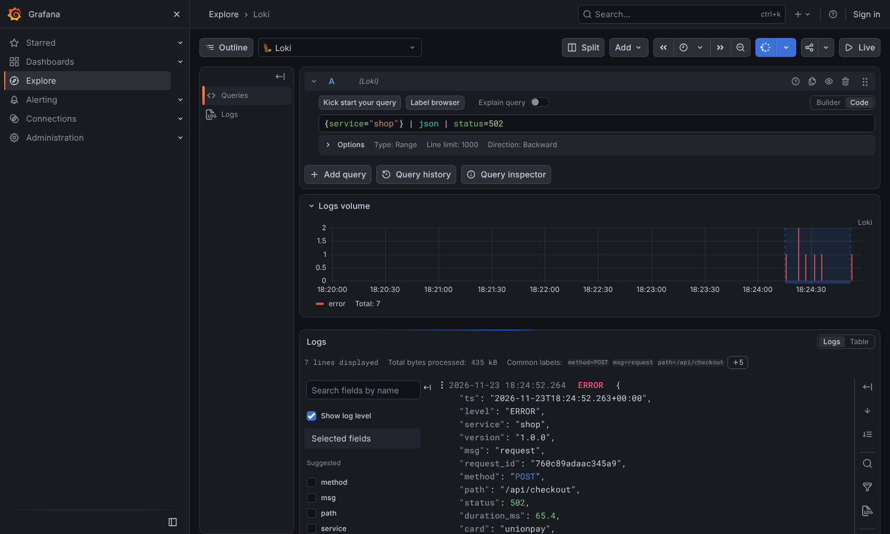

All lines of that request from both services with one query:

```logql
{service=~"shop|payments"} |= "5ed1b80addd84306"
```

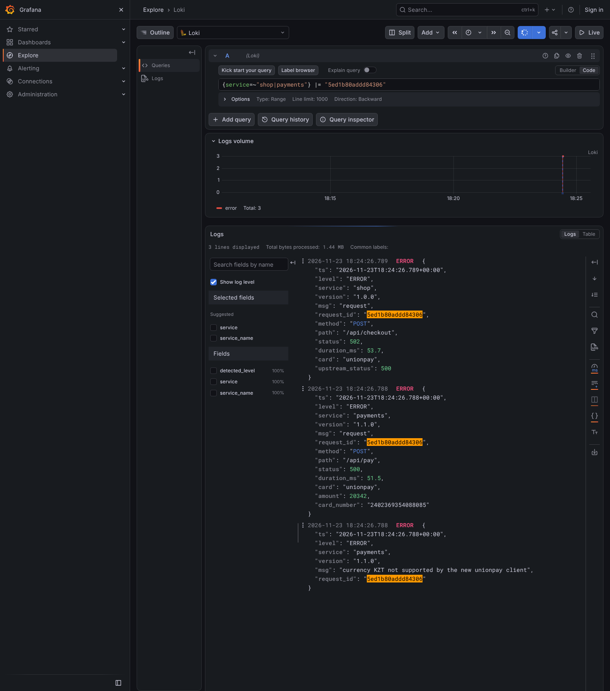

The story of one request (3 lines): payments 1.1.0 logs `currency KZT not supported by the new unionpay client`, then its access line `POST /api/pay` → 500 (card `unionpay`); the shop logs `POST /api/checkout` → 502 with `upstream_status: 500`. Same `request_id`, timestamps 1 ms apart.

My own request with a chosen ID:

```bash
curl -si -X POST localhost:8000/api/checkout -H 'X-Request-ID: lab-ruslanbek-1' \
  -H 'Content-Type: application/json' \
  -d '{"card":"unionpay","amount":1000,"card_number":"4000000000000000"}'
```

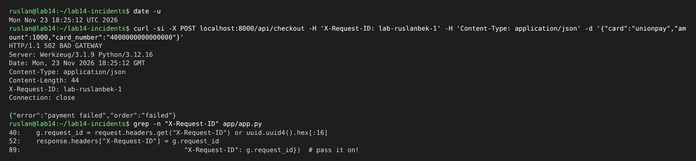

```logql
{service=~"shop|payments"} |= "lab-ruslanbek-1"
```


**Where the ID is passed on.** `app.py` line 40 takes the incoming `X-Request-ID` or makes a new one; line 52 returns it to the client; line 89, in `checkout()`, puts it into the headers of the call to payments:

```python
req = urllib.request.Request(f"{PAYMENTS_URL}/api/pay", data=json.dumps(order).encode(),
                             headers={"Content-Type": "application/json",
                                      "X-Request-ID": g.request_id})  # pass it on!
```

Without that header payments would not receive the ID and would generate its own random one in `start()`. The shop line and the payments line of the same checkout would have different `request_id`s, so the query above would return only the shop line (502, "payment failed") and the real cause (`currency KZT not supported…`) could be matched only by guessing from timestamps.

**Why `service` is a label but `request_id` is not.** Loki indexes only labels; every unique label set is a separate stream. `service` has a handful of values, so it is a good label to choose streams. `request_id` is unique per request: as a label it would create millions of tiny streams (high cardinality), blow up the index and make Loki slow and expensive. It stays in the log line and is found with a filter (`|= "…"` or `| json | request_id="…"`) inside the few streams the labels select.

**How a request_id turns two logs into one story; what a trace adds.** The ID is the join key: one query returns the lines of every service that touched the request, in order, so the 502 in the shop is directly connected to the 500 and the error message in payments. A distributed trace (OpenTelemetry, Tempo/Jaeger) adds the structure and timing: a span per service call with parent/child links, start time and duration of every hop, so you see the call tree and where the time went (for example, which of five downstream calls was slow) without reading log lines.

## Task 5 — The dashboard, as code

Dashboard **ShopLab — RED** (`uid: shoplab-red`), stored as `dashboards/shoplab.json` and loaded by the provider `monitoring/grafana/dashboards/provider.yml` into the folder `lab14`.

| Row / panel | Query | Unit |
|---|---|---|
| **Users: are requests served? (on-call)** | | |
| Rate by service/route | `sum by (job, route) (rate(http_requests_total[1m]))` | req/s |
| 5xx ratio by service | `(sum by (job) (rate(http_requests_total{status=~"5.."}[5m])) or sum by (job) (rate(http_requests_total[5m])) * 0) / sum by (job) (rate(http_requests_total[5m]))` | percentunit |
| p95 latency by route | `histogram_quantile(0.95, sum by (job, route, le) (rate(http_request_duration_seconds_bucket[5m])))` | s |
| **SLO and investigation (service owners)** | | |
| Checkout error budget: burn rate | `shop:checkout_error_ratio:rate5m / 0.005` (+ 30m, 1h, 6h); threshold lines at **6** and **14.4** | none (×) |
| Errors in logs (Loki) | `{service=~"shop|payments"} \| json \| level="ERROR"` | logs |

All time series panels have `min: 0` (y-axis from 0) and their unit set.

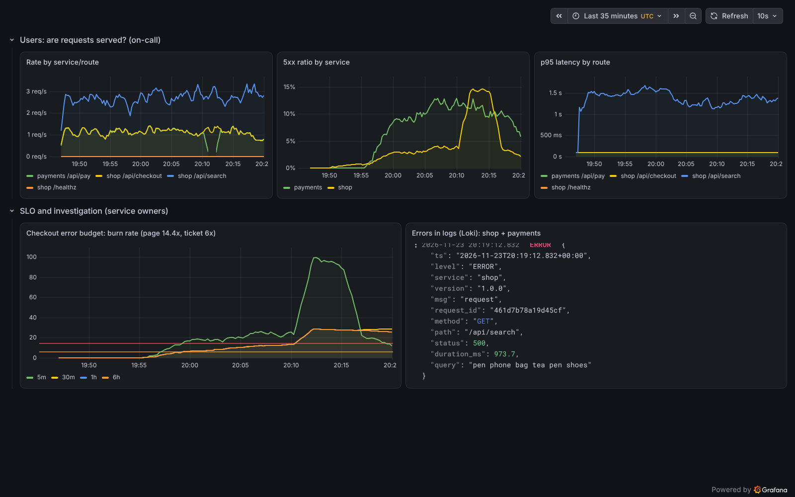

It loads by itself after a full restart:

```bash
docker compose down && docker compose up -d
curl -s 'localhost:3000/api/search?query=ShopLab'
```

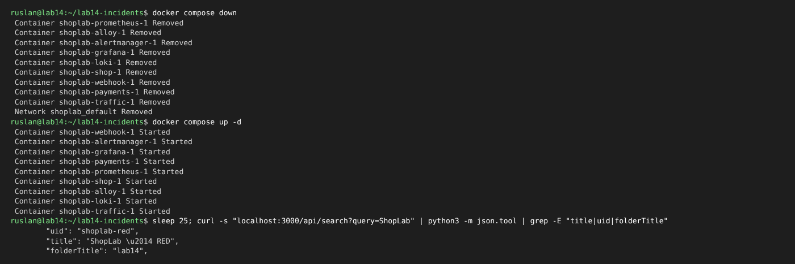

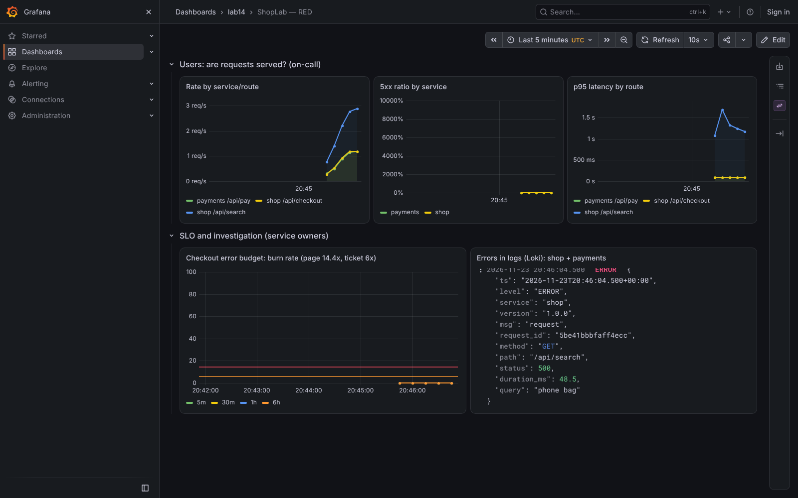

**Why keep dashboards in git?** A dashboard made by clicking lives only in Grafana's database: it is lost with the container, can't be reviewed, has no history and can't be copied to another environment. As JSON in git it is versioned, reviewed in a PR together with the metric or alert it shows, restored automatically on every start (provisioning) and identical on every stack.

**Who is each row for?** The top row (rate, errors, latency per service/route — RED) is for the on-call engineer and anyone asking "is the shop OK right now?": it shows in seconds whether users are served and which service is failing. The bottom row is for the service owners and the incident investigation: the checkout burn rate shows how much of the SLO is being spent and whether it is a page (14.4×) or a ticket (6×), and the logs panel gives the error messages from both services for the "what" and the `request_id`s to follow.

## Final Challenge

Reproduced in order (Prometheus and Alertmanager re-created with empty storage at 19:46:30 so the SLO windows start clean):

```bash
date -u; PAYMENTS_VERSION=1.1.0 docker compose up -d payments   # 19:55:00
date -u; docker compose stop payments                           # 20:10:00
date -u; docker compose start payments                          # 20:12:00
date -u; docker compose up -d payments                          # 20:17:00 rollback to 1.0.0
```

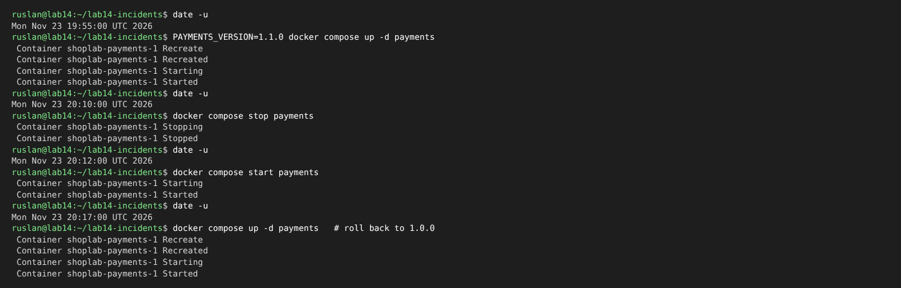

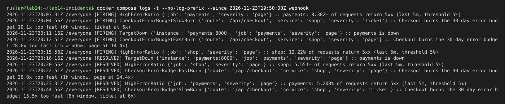

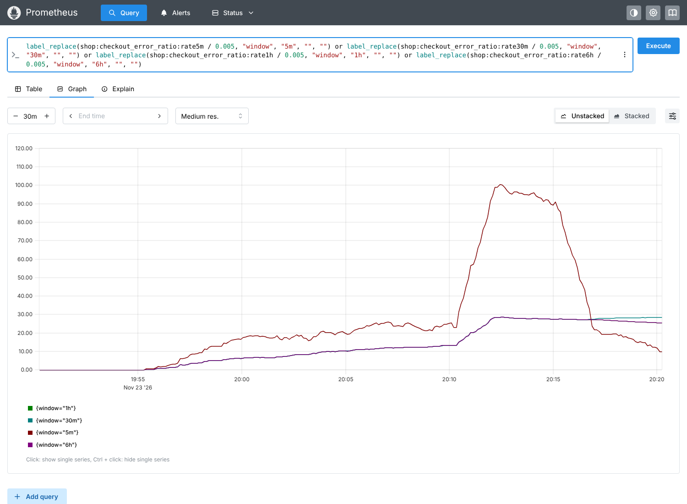

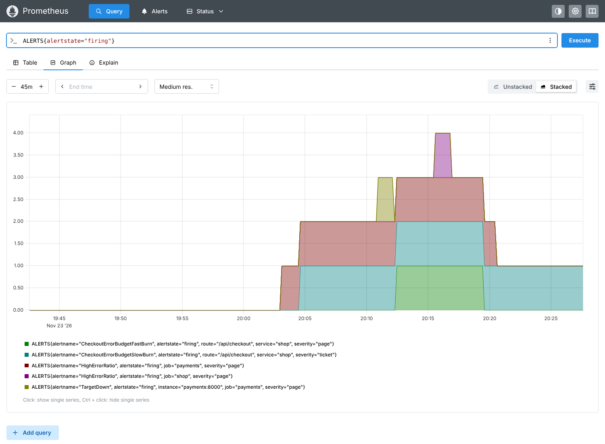

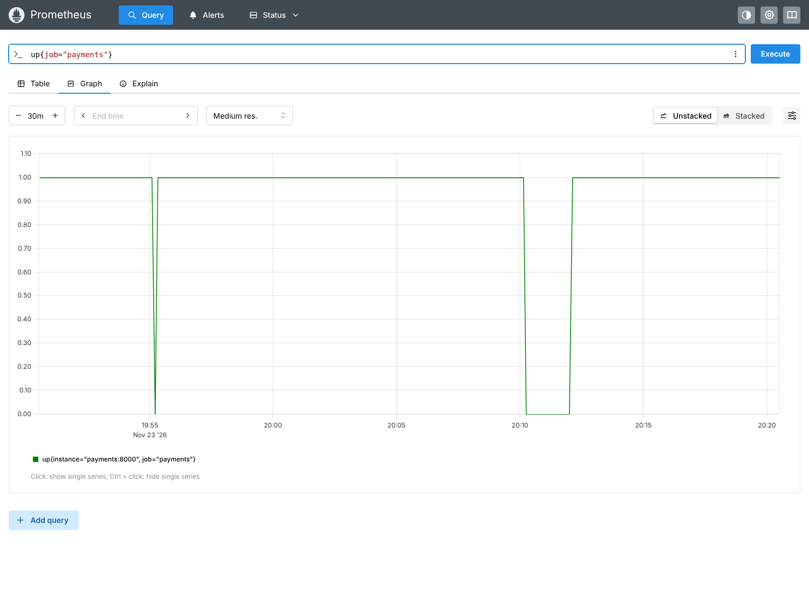

![changes(process_start_time_seconds{job="payments"}[1h]): deploy 19:55, start 20:12, rollback 20:17](screens/fc-restarts.png)

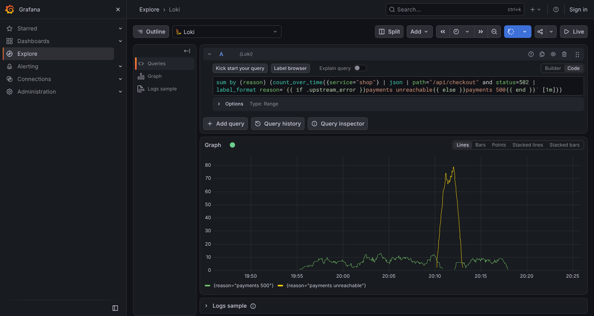

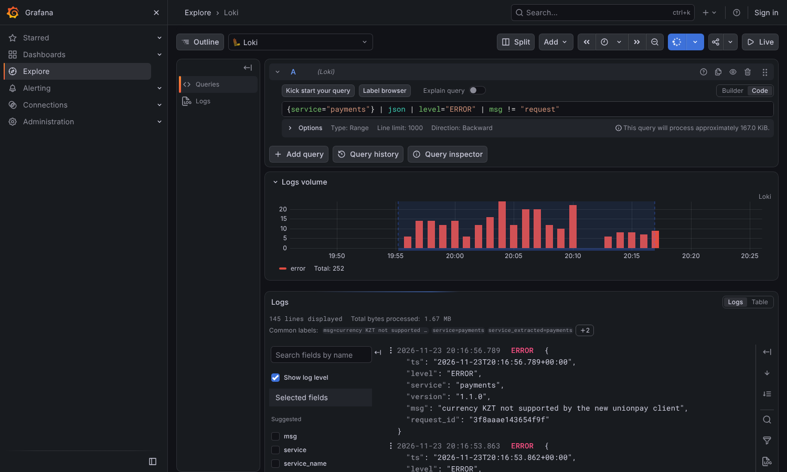

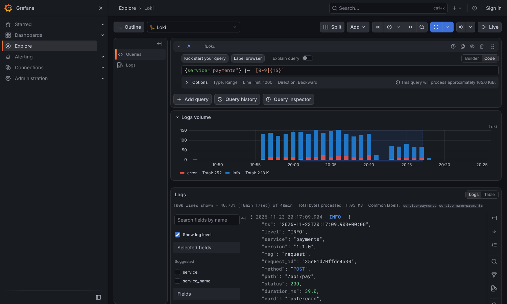

The full analysis is in [POSTMORTEM.md](POSTMORTEM.md): 289 of 2003 checkouts failed (145 unionpay 500s from 1.1.0, 143 "payments unreachable" during the 2-minute outage), 22 minutes of impact, **2.0 % of the 30-day error budget** (4.3 of 216 minutes). The first useful alert was `HighErrorRatio {job="payments"}` 8.5 minutes after the deploy.

## Cleanup

```bash
git status                       # no .env, no secrets
docker compose down -v           # -v: Prometheus/Alertmanager/Loki/Grafana anonymous volumes
docker image rm shoplab-app:1
```

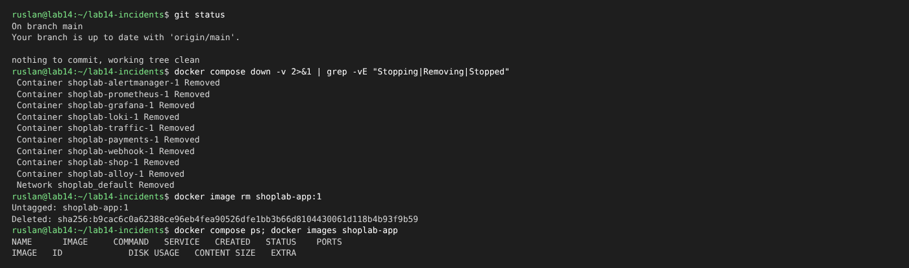
